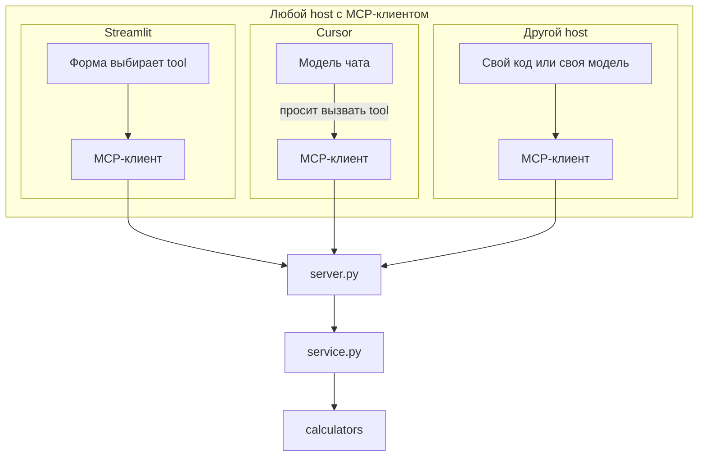
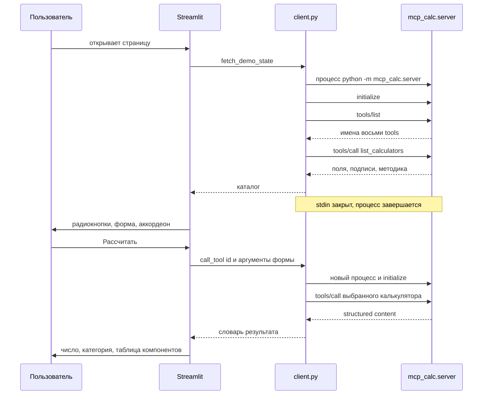
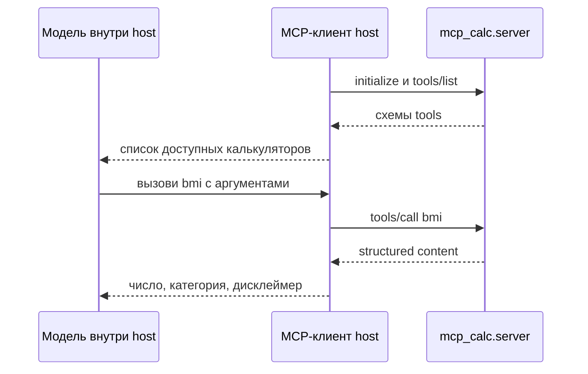
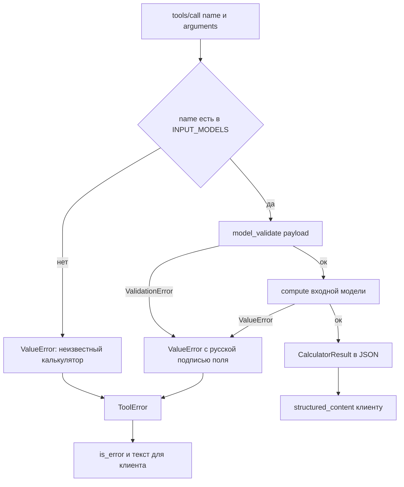
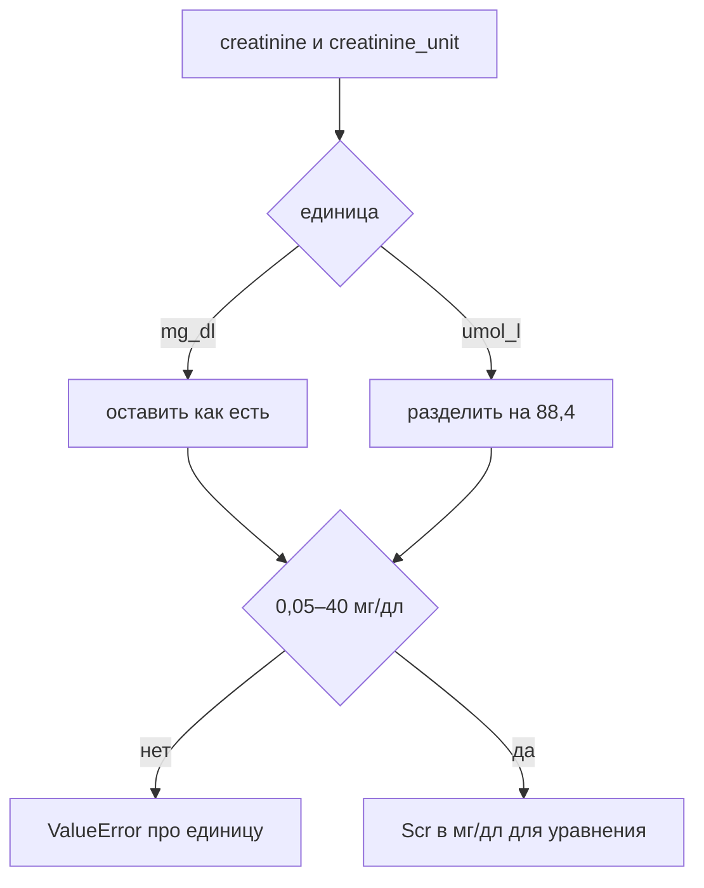
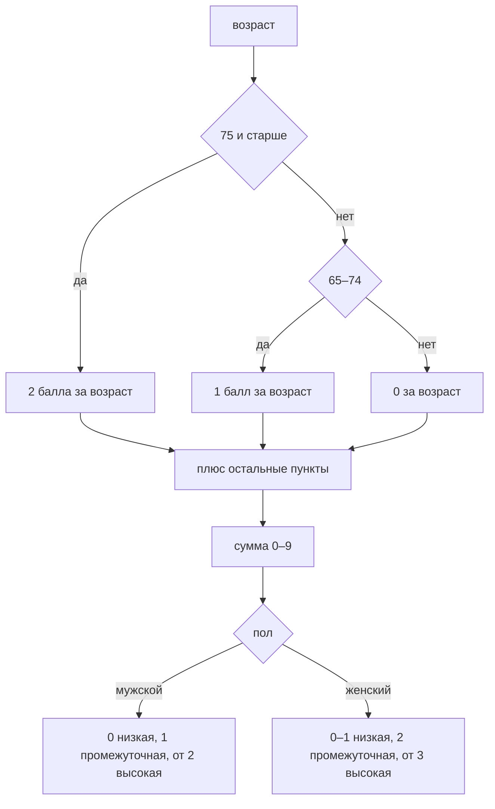

# Медицинские калькуляторы (MCP + Streamlit)

Локальный MCP-сервер с семью учебными калькуляторами и Streamlit-демо, которое ходит в него по протоколу MCP. Формулы отделены от транспорта: сервер проверяет вход, считает и возвращает число, пояснение порогов, разложение на компоненты и дисклеймер.

Результат получен по опубликованной формуле и предназначен только для обучения и демонстрации. Он не является диагнозом, медицинской рекомендацией и не заменяет консультацию врача.

## Состав

| Tool | Расчёт |
| --- | --- |
| `bmi` | индекс массы тела, категории WHO |
| `bsa_mosteller` | площадь поверхности тела по Mosteller |
| `egfr_ckd_epi_2021` | рСКФ CKD-EPI 2021 по креатинину, без расового коэффициента |
| `cockcroft_gault` | клиренс креатинина, без нормировки на 1,73 м² |
| `cha2ds2_vasc` | сумма баллов CHA₂DS₂-VASc |
| `curb65` | тяжесть внебольничной пневмонии |
| `qtc` | QTc по Bazett и Fridericia |
| `list_calculators` | каталог: поля, подписи, методика в Markdown |

Креатинин принимается в мкмоль/л или мг/дл. В уравнение он переводится делением на 88,4.

## Зачем это нужно

Калькулятор переводит измерения и факты из истории болезни в одно число по опубликованной формуле. С этим числом сверяют известные пороги. Считать дробные степени CKD-EPI или баллы шкалы вручную легко ошибиться, а два расчёта с одними и теми же цифрами должны совпасть.

Ими пользуются врачи, клинические фармакологи, студенты и программы, которым нужно одно и то же значение при каждом вызове. В этом репозитории расчёт доступен форме Streamlit и любому MCP-клиенту. Если tool вызывает модель в чате, арифметику всё равно выполняет сервер: модель только передаёт вход и читает ответ.

| Калькулятор | Для чего смотрят число |
| --- | --- |
| Индекс массы тела | Категория массы по росту, пороги WHO |
| Площадь поверхности тела | Дозы, которые назначают на квадратный метр |
| рСКФ и клиренс креатинина | Ориентир функции почек, когда дозу лекарства связывают с выведением через почки |
| CHA₂DS₂-VASc | Балл шкалы риска инсульта при фибрилляции предсердий |
| CURB-65 | Сжатая оценка тяжести внебольничной пневмонии |
| QTc | Интервал QT, приведённый к частоте пульса, перед препаратами, которые его удлиняют |

Число решение не принимает. Категория СКФ описывает только расчётную фильтрацию, балл CHA₂DS₂-VASc не назначает антикоагулянт, тяжесть CURB-65 не является правилом госпитализации. К порогу добавляют осмотр, остальные анализы и течение болезни.

## Примеры

Все значения ниже получены вызовом `run_calculator` этого репозитория.

Один и тот же креатинин 130 мкмоль/л у мужчины даёт разную рСКФ, потому что в CKD-EPI входит возраст.

| Возраст | рСКФ | Категория |
| --- | --- | --- |
| 40 лет | 61,4 мл/мин/1,73 м² | G2, незначительно сниженная |
| 80 лет | 47,9 мл/мин/1,73 м² | G3a, от незначительно до умеренно сниженная |

Строка анализа выглядит одинаково. Расчёт показывает, что у 80-летнего фильтрация уже в другом диапазоне KDIGO. От таких диапазонов часто отталкиваются, когда решают, оставлять ли обычную дозу лекарства, которое выводится почками.

У женщины 80 лет, 60 кг, с тем же креатинином 130 мкмоль/л клиренс по Cockcroft–Gault равен 28,9 мл/мин. Ориентир для дозирования — 15–29 мл/мин. Креатинин кажется лишь умеренно высоким, а клиренс попадает в диапазон, для которого инструкции ко многим лекарствам предусматривают снижение дозы. Это клиренс, а не нормированная СКФ: подставляется введённая масса, без замены на идеальную.

Площадь тела меняет дозу, даже если схема на квадратный метр одна и та же. При 75 мг/м²:

| Рост и масса | BSA по Mosteller | Доза 75 мг/м² |
| --- | --- | --- |
| 175 см, 70 кг | 1,84 м² | 138 мг |
| 160 см, 100 кг | 2,11 м² | 158 мг |

Доза в таблице — произведение 75 мг/м² и площади с карточки, округлённое до целого миллиграмма. Разница около 15 % возникает только из роста и массы. Индекс массы тела для 160 см и 100 кг равен 39,1 кг/м² — ожирение II степени по WHO.

Пропущенный пункт анамнеза сдвигает CHA₂DS₂-VASc через порог. Женщина 64 лет и без других пунктов получает 1 балл за пол: низкая категория. Тот же возраст и инсульт в анамнезе дают 3 балла: высокая категория. Два балла за один факт меняют порог шкалы. Это справка по баллам, а не назначение антикоагулянта.

Несколько скромных отклонений складываются в высокую тяжесть пневмонии. Возраст 70 лет, мочевина 8,5 ммоль/л, частота дыхания 32, диастолическое давление 60: CURB-65 равен 4 баллам. По отдельности это обычные строки карты, вместе шкала называет высокую тяжесть. Госпитализацию шкала сама не назначает.

Сырой QT может выглядеть спокойно. Интервал 400 мс при пульсе 80 у мужчины: Bazett 462 мс, уже удлинённый QT для мужчины, Fridericia 440 мс и ещё в пределах порога. Без частоты пульса цифра 400 этого не показывает, а выбор формулы меняет подпись. Перед препаратом, который удлиняет QT, смотрят корригированное значение.

## Как устроено

Сервер не привязан к Cursor и не требует модель. К нему подключается любой host, который сам умеет быть MCP-клиентом и запустить локальный процесс по stdio. В ролях три участника:

| Роль | Кто это здесь |
| --- | --- |
| Host | Приложение: Streamlit, Cursor, Claude Desktop, VS Code, свой скрипт на SDK |
| MCP-клиент | Соединение внутри host с одним сервером. Оно шлёт JSON-RPC |
| Сервер | `python -m mcp_calc.server`, одни и те же tools для всех host |

Агент — выбранная в host модель чата. Она протокол не ведёт: просит host вызвать tool, а вызов делает MCP-клиент этого host. Если host выбирает tool сам, как форма Streamlit, агент в цепочке не нужен.



Слои:

| Слой | Модуль | Роль |
| --- | --- | --- |
| Транспорт | `server.py` | Регистрирует tools, принимает stdio, переводит `ValueError` в `ToolError` |
| Каталог | `registry.py`, `methodology.py` | Имена, поля формы, короткая формула, источник, методика в Markdown |
| Вызов | `service.py` | Ищет калькулятор, проверяет payload, возвращает словарь результата |
| Формулы | `calculators/` | Чистые функции. Не знают про MCP |
| Общее | `models.py`, `domain.py`, `formatting.py`, `results.py` | Контракт ответа, пол, перевод креатинина, округление |
| Демо-клиент | `client.py`, `streamlit_app/app.py` | Поднимает сервер, строит форму из каталога, рисует ответ |

```text
MCP_calc/
  pyproject.toml
  streamlit_app/app.py
  src/mcp_calc/
    server.py
    client.py
    service.py
    registry.py
    methodology.py
    models.py
    domain.py
    formatting.py
    results.py
    calculators/
  tests/
  .cursor/mcp.json
```

Запуск сервера: `python -m mcp_calc.server`. Класс сервера — `MCPServer` из пакета `mcp` 2.x. Транспорт по умолчанию — stdio: сообщения JSON-RPC идут построчно в stdin и stdout. Журнал пишется в stderr, чтобы не смешиваться с протоколом.

Каждый tool помечен как только чтение (`readOnlyHint`) и без выхода во внешний мир (`openWorldHint`). Сервер ничего не сохраняет и никуда не ходит по сети.

## Алгоритм демо в Streamlit

Страница — отдельный host без модели. Она не импортирует формулы и дважды за сессию говорит с сервером: один раз за каталогом, второй раз за расчётом. На каждую операцию поднимается новый процесс, сессия короткая. Другой host вызывает те же методы, но может держать один процесс открытым, пока открыт чат.



Каталог кэшируется в `st.cache_data`. Кнопка «Переподключить» сбрасывает кэш и повторяет первый обмен. Расчёт не кэшируется: каждое нажатие — новый процесс и новый `tools/call`.

Идентификатор tool берётся из выбранного пункта меню. Аргументы — из виджетов, которые построены по полю `inputs` каталога. Свободный текст на этой странице никто не разбирает.

Тот же сервер принимает вызов от host, в котором tool выбирает модель. Протокол от этого не меняется: до сервера доходит обычный `tools/call`.



## Алгоритм одного вызова



Проверка входа двухуровневая.

1. Схема tool, которую MCP строит из аннотаций функции. Сюда попадают типы, описания и enum `male` / `female`, `umol_l` / `mg_dl`.
2. Pydantic-модель калькулятора в `service.run_calculator`: границы чисел, запрет лишних полей, затем правила самой формулы. Например, диастолическое давление не может быть выше систолического, а креатинин после перевода в мг/дл должен лежать в диапазоне 0,05–40.

`ValueError` из расчёта на границе сервера становится `ToolError`. Клиент видит текст ошибки, а не обрыв процесса. Streamlit срезает префикс `Error executing tool ...:` и показывает русское сообщение.

Округление везде одно: половина вверх через `Decimal`, не банковское `round`. Категория выбирается по уже округлённому числу, чтобы подпись совпадала с цифрой на карточке.

Общий вид ответа:

| Поле | Смысл |
| --- | --- |
| `calculator_id` | имя tool |
| `name` | название на русском |
| `value` | округлённое число |
| `value_display` | то же число строкой, без хвоста двоичной дроби |
| `unit` | единица или слово «балл» с нужным окончанием |
| `interpretation` | категория по опубликованным порогам |
| `formula` | короткая запись формулы |
| `reference` | источник |
| `inputs_used` | вход после проверки |
| `components` | слагаемые шкалы или промежуточные величины |
| `disclaimer` | учебный статус результата |

## Алгоритмы калькуляторов

Методика, которую видит пользователь в аккордеоне, лежит в `methodology.py` и уходит клиенту внутри `list_calculators`. Ниже тот же порядок шагов, по которому считает код.

### Общий перевод креатинина

Нужен для рСКФ и Cockcroft–Gault.



### Индекс массы тела

1. Перевести рост из сантиметров в метры.
2. Посчитать `масса_кг / рост_м²`.
3. Округлить до 0,1.
4. Назначить категорию WHO по округлённому значению.

| BMI | Категория |
| --- | --- |
| меньше 18,5 | недостаточная масса тела |
| 18,5–24,9 | нормальная масса тела |
| 25,0–29,9 | избыточная масса тела |
| 30,0–34,9 | ожирение I степени |
| 35,0–39,9 | ожирение II степени |
| 40 и больше | ожирение III степени |

Источник: WHO Technical Report Series 894, 2000.

### Площадь поверхности тела

$$
BSA = \sqrt{\frac{\text{рост (см)} \times \text{масса (кг)}}{3600}}
$$

Округление до 0,01 м². Порогов нет: интерпретация только называет формулу Mosteller, 1987.

### рСКФ CKD-EPI 2021

Уравнение для взрослых от 18 лет. Расовый коэффициент не используется. `Scr` — креатинин в мг/дл.

$$
eGFR = 142 \times \min(Scr/\kappa,\ 1)^{\alpha} \times \max(Scr/\kappa,\ 1)^{-1.200} \times 0.9938^{\text{возраст}} \times s
$$

| Пол | κ | α | множитель s |
| --- | --- | --- | --- |
| мужской | 0,9 | −0,302 | 1 |
| женский | 0,7 | −0,241 | 1,012 |

Результат округляется до 0,1 мл/мин/1,73 м². Категория KDIGO берётся по этому числу и описывает только величину СКФ.

| СКФ | Категория |
| --- | --- |
| ≥ 90 | G1, высокая или нормальная |
| 60–89 | G2, незначительно сниженная |
| 45–59 | G3a, от незначительно до умеренно сниженная |
| 30–44 | G3b, от умеренно до существенно сниженная |
| 15–29 | G4, существенно сниженная |
| меньше 15 | G5, диапазон почечной недостаточности |

Источник уравнения: Inker et al., NEJM, 2021. Границы категорий: KDIGO 2012.

### Клиренс креатинина

$$
CrCl = \frac{(140 - \text{возраст}) \times \text{масса (кг)} \times k}{72 \times Scr}
$$

`k` равен 1 у мужчин и 0,85 у женщин. `Scr` в мг/дл. В числитель подставляется введённая масса, без замены на идеальную. Результат в мл/мин, без деления на площадь тела, округление до 0,1.

Ориентир для дозирования, не стадия CKD:

| Клиренс, мл/мин | Подпись |
| --- | --- |
| ≥ 90 | ≥ 90 мл/мин |
| 60–89 | 60–89 мл/мин |
| 30–59 | 30–59 мл/мин |
| 15–29 | 15–29 мл/мин |
| меньше 15 | меньше 15 мл/мин |

Источник: Cockcroft and Gault, Nephron, 1976.

### CHA₂DS₂-VASc

Баллы складываются. Два возрастных пункта не ставятся вместе.



| Пункт | Баллы |
| --- | --- |
| Сердечная недостаточность или дисфункция левого желудочка | 1 |
| Артериальная гипертензия | 1 |
| Возраст ≥ 75 лет | 2 |
| Сахарный диабет | 1 |
| Инсульт, ТИА или артериальная тромбоэмболия | 2 |
| Сосудистое заболевание | 1 |
| Возраст 65–74 года | 1 |
| Женский пол | 1 |

У женщины один балл может давать только пол, поэтому 0 и 1 попадают в низкую категорию. Подпись прямо говорит, что это справка по шкале, а не назначение антикоагулянта.

Источник шкалы: Lip et al., Chest, 2010.

### CURB-65

Каждый выполненный пункт даёт 1 балл. Перед суммой проверяется, что диастолическое давление не выше систолического.

| Пункт | Условие балла |
| --- | --- |
| Сознание | отмечено новое нарушение |
| Мочевина | строго больше 7 ммоль/л, это мочевина плазмы, не BUN в мг/дл |
| Дыхание | 30 и больше в минуту |
| Давление | систолическое меньше 90 или диастолическое 60 и ниже |
| Возраст | 65 лет и старше |

| Сумма | Тяжесть |
| --- | --- |
| 0–1 | низкая |
| 2 | средняя |
| 3–5 | высокая |

Стратификация не является правилом госпитализации. Источник: Lim et al., Thorax, 2003.

### Корригированный QT

1. Перевести частоту пульса в интервал RR в секундах: `RR = 60 / ЧСС`.
2. Посчитать две оценки из измеренного QT в миллисекундах.

$$
QTc_{Bazett} = \frac{QT}{\sqrt{RR}}, \qquad QTc_{Fridericia} = \frac{QT}{RR^{1/3}}
$$

3. Округлить каждую до целых миллисекунд.
4. На карточке основным числом показать Bazett. Обе оценки и RR положить в `components`.
5. Категорию каждой оценки выбрать отдельно.

| Округлённый QTc | Категория |
| --- | --- |
| ≥ 500 мс | выраженно удлинённый |
| ≥ 450 мс у мужчины или ≥ 460 мс у женщины | удлинённый |
| ≤ 350 мс | ниже учебного порога укороченного QT |
| иначе | в пределах этих порогов |

Если категории Bazett и Fridericia различаются, текст ответа говорит об этом: при пульсе далеко от 60 ударов в минуту Bazett смещает QTc сильнее.

Источники формул: Bazett, 1920; Fridericia, 1920. Пороги удлинения: Rautaharju et al., Circulation, 2009.

## Запуск

Нужен Python 3.11 или новее. Команды для PowerShell из корня проекта. Окружение в репозитории собрано на Python 3.12.

```powershell
py -3.12 -m venv .venv
.\.venv\Scripts\python.exe -m pip install -e ".[dev]"
.\.venv\Scripts\python.exe -m pytest
.\.venv\Scripts\python.exe -m streamlit run streamlit_app/app.py
```

Демо открывается на `http://localhost:8501`.

Тесты покрывают известные численные примеры, границы категорий, расхождение Bazett и Fridericia, отказ на неверном входе, регистрацию tools и один полный обмен по stdio.

## Подключение host-приложения

Любой MCP-клиент со stdio запускает тот же модуль. Команда и переменные общие: интерпретатор из `.venv`, аргумент `-m mcp_calc.server`, `PYTHONUTF8=1` и `PYTHONIOENCODING=utf-8`. Пакет уже установлен в этот интерпретатор, отдельный `PYTHONPATH` не нужен. `PYTHONUTF8` нужен, чтобы русские строки в JSON не зависели от кодировки консоли Windows. Если окружение лежит в другом месте, в команде меняется только путь к `python`.

Для Cursor готовый файл уже есть: `.cursor/mcp.json`. После установки пакета включите сервер `medical-calculators` в настройках MCP. Модель чата увидит tools и сможет просить Cursor их вызывать. Файл на работу Streamlit не влияет: демо подключается своим клиентом в `client.py`.

```json
{
  "mcpServers": {
    "medical-calculators": {
      "command": "C:\\Users\\user\\PycharmProjects\\MCP_calc\\.venv\\Scripts\\python.exe",
      "args": ["-m", "mcp_calc.server"],
      "env": {
        "PYTHONUTF8": "1",
        "PYTHONIOENCODING": "utf-8"
      }
    }
  }
}
```
