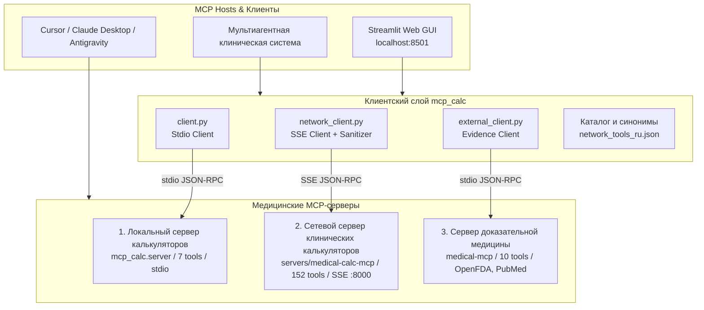

# Медицинские калькуляторы (MCP + Streamlit)

> **Учебный проект для слушателей курса «Программная инженерия мультиагентных систем клинической медицины»**  
> *Университет Иннополис, осень 2026*

Комплексный проект демонстрации и практического освоения технологий **Model Context Protocol (MCP)** в клинической медицине. Репозиторий объединяет три независимых медицинских MCP-сервера, адаптивный клиентский слой с русской локализацией и интерактивный веб-интерфейс на **Streamlit**.

> [!IMPORTANT]
> **Дисклеймер:** Проект предназначен исключительно для учебных и научно-исследовательских целей. Все расчёты производятся по опубликованным валидированным клиническим формулам, однако результаты не являются медицинским диагнозом или клинической рекомендацией и не заменяют консультацию квалифицированного врача.

---

## 🌟 Архитектура и состав системы

Проект реализует мультисерверную архитектуру на базе открытого протокола **Model Context Protocol (MCP)**:



---

## 🧮 Поддерживаемые серверы

### 1. Локальный MCP-сервер (7 базовых калькуляторов)
* **Транспорт:** `stdio` (JSON-RPC 2.0 via Python `mcp` SDK).
* **Модуль:** `python -m mcp_calc.server`.
* **Архитектура:** Чистые функции, строгая валидация Pydantic, округление через `Decimal` (половина вверх), подробные разложения компонентов:
  - `bmi` — индекс массы тела (категории ВОЗ).
  - `bsa_mosteller` — площадь поверхности тела по Мостеллеру (м²).
  - `egfr_ckd_epi_2021` — расчетная скорость клубочковой фильтрации (рСКФ) по формуле CKD-EPI 2021 без расового коэффициента (стадии KDIGO).
  - `cockcroft_gault` — клиренс креатинина по Кокрофту — Голту для подбора дозировок препаратов.
  - `cha2ds2_vasc` — оценка риска тромбоэмболических осложнений при фибрилляции предсердий.
  - `curb65` — стратификация тяжести внебольничной пневмонии.
  - `qtc` — корригированный интервал QT по Базетту и Фридеричиа с автоопределением удлинения.
  - `list_calculators` — мета-инструмент каталога с описаниями, полями и клинической методикой.

### 2. Сетевой MCP-сервер (152 клинических калькулятора)
* **Транспорт:** `SSE` (Server-Sent Events) на `http://127.0.0.1:8000/sse`.
* **Исходный код:** директория [servers/medical-calc-mcp/](servers/medical-calc-mcp/).
* **Архитектура:** Domain-Driven Design (DDD Onion Architecture), FastMCP, модульная маршрутизация.
* **Особенности:**
  - Охватывает кардиологию, реанимацию и ИТАР, нефрологию, хирургию, гепатологию, травматологию, педиатрию и акушерство.
  - Полная русификация всех 133 модулей калькуляторов (0 китайских символов, русские докстринги, подписи параметров и рекомендации).
  - Все файлы снабжены официальным учебным заголовком курса Университета Иннополис.
  - Встроенный каталог доказательной базы: ссылки на статьи с PMID (PubMed ID) и DOI.

### 3. Внешний MCP-сервер доказательной медицины (10 инструментов)
* **Транспорт:** `stdio` через Node.js (`medical-mcp`).
* **Возможности:**
  - Поиск инструкций лекарств и побочных эффектов в базе **FDA / DailyMed**.
  - Научный поиск публикаций в **PubMed**.
  - Поиск текущих клинических исследований в **ClinicalTrials.gov**.
  - Проверка межлекарственных взаимодействий и классов веществ через **RxNorm**.

---

## 🖥️ Веб-интерфейс Streamlit

Приложение запускается на `http://localhost:8501` и включает:
1. **Умный поиск калькуляторов:**
   - Полнотекстовый поиск по русским и английским названиям, описаниям и аббревиатурам.
   - Поддержка клинической морфологии: например, запрос `"инф"` мгновенно находит инфаркты (TIMI), инфекции (CPIS, SIRS, Pitt), инфузии (Parkland) — более 25 релевантных инструментов.
2. **Адаптивная генерация клинических форм:**
   - Для категориальных переменных автоматически формируются выпадающие списки (выбор тяжести асцита, классов энцефалопатии, локализации травмы, кардиохирургического риска).
   - Для числовых показателей подставляются безопасные клинические значения по умолчанию (Smart Defaults), предотвращающие ошибки валидации.
3. **Отображение результатов:**
   - Балл или расчетное значение с единицами измерения.
   - Клиническая интерпретация (уровень риска, тяжесть по шкалам).
   - Рекомендации по ведению и дальнейшим шагам.
   - Разложение результата по слагаемым компонентам.
   - Первоисточники с клиническими рекомендациями и DOI/PubMed.
4. **Инспектор MCP JSON:**
   - Прозрачный просмотр структурированного JSON-RPC запроса и ответа сервера.

---

## 🚀 Быстрый старт

### Требования
* **ОС:** Windows 10/11, macOS или Linux
* **Python:** 3.11 или 3.12
* **Node.js:** 18+ (для внешнего сервера `medical-mcp`)

### 1. Клонирование и установка зависимостей
```powershell
git clone https://github.com/EdwFa/MCP_calc.git
cd MCP_calc

# Создание виртуального окружения
py -3.12 -m venv .venv
.\.venv\Scripts\Activate.ps1

# Установка пакета в режиме разработки
pip install -e ".[dev]"
```

### 2. Запуск тестов
Прогон набора модульных и интеграционных тестов:
```powershell
python -m pytest
```
*(Все 61 тест должны завершиться успешно)*.

### 3. Запуск сетевого MCP-сервера (152 калькулятора)
В отдельном терминале запустите готовый скрипт:
```powershell
.\scripts\start_network_server.bat
```
Либо напрямую через Python:
```powershell
cd servers/medical-calc-mcp
.\.venv\Scripts\python.exe -m src.main --mode sse --host 127.0.0.1 --port 8000
```
Сервер будет доступен по адресу: `http://127.0.0.1:8000/sse`.

### 4. Запуск Streamlit GUI
```powershell
python -m streamlit run streamlit_app/app.py
```
Откройте браузер по адресу: `http://localhost:8501`.

---

## 🔌 Подключение к MCP-клиентам

### Настройка в Cursor (`.cursor/mcp.json`)
В корне проекта находится готовый конфигурационный файл `.cursor/mcp.json`, позволяющий ИИ-агентам Cursor вызывать калькуляторы:

```json
{
  "mcpServers": {
    "medical-calculators": {
      "command": "C:\\Innopol\\MCP_calc\\.venv\\Scripts\\python.exe",
      "args": ["-m", "mcp_calc.server"],
      "env": {
        "PYTHONUTF8": "1",
        "PYTHONIOENCODING": "utf-8"
      }
    },
    "medical-mcp": {
      "command": "node",
      "args": [
        "C:\\Users\\user\\AppData\\Roaming\\npm\\node_modules\\medical-mcp\\build\\index.js"
      ],
      "env": {
        "PUPPETEER_SKIP_DOWNLOAD": "true"
      }
    },
    "medical-calc-network": {
      "url": "http://127.0.0.1:8000/sse"
    }
  }
}
```

### Настройка в Claude Desktop
Добавьте в `%APPDATA%\Claude\claude_desktop_config.json`:
```json
{
  "mcpServers": {
    "medical-calc": {
      "command": "C:\\Innopol\\MCP_calc\\.venv\\Scripts\\python.exe",
      "args": ["-m", "mcp_calc.server"],
      "env": {
        "PYTHONUTF8": "1",
        "PYTHONIOENCODING": "utf-8"
      }
    }
  }
}
```

---

## 📁 Структура репозитория

```text
MCP_calc/
├── pyproject.toml                         # Конфигурация проекта и зависимости
├── README.md                              # Описание проекта и руководство
├── streamlit_app/
│   └── app.py                             # Интерактивное веб-приложение Streamlit
├── src/mcp_calc/                          # Основной пакет библиотеки
│   ├── server.py                          # Локальный MCP-сервер (stdio)
│   ├── service.py                         # Слой выполнения калькуляторов
│   ├── registry.py                        # Реестр метаданных 7 локальных шкал
│   ├── methodology.py                     # Медицинские формулы и описания
│   ├── network_client.py                  # Асинхронный клиент для SSE-сервера
│   ├── external_client.py                 # Клиент доказательной медицины (medical-mcp)
│   ├── network_tools_ru.json              # Каталог 152 калькуляторов на русском языке
│   ├── clinical_phrases_ru.json           # Словарь клинических синонимов
│   └── calculators/                       # Формулы локальных калькуляторов
├── servers/
│   └── medical-calc-mcp/                  # Сервер 152 калькуляторов (FastMCP, SSE)
│       ├── src/domain/services/calculators/ # 133 модуля калькуляторов
│       ├── src/main.py                    # Точка входа сетевого сервера
│       └── ...
├── scripts/
│   ├── start_network_server.bat           # Скрипт быстрого запуска SSE-сервера
│   ├── generate_ru_catalog.py             # Генератор русского каталога
│   └── translate_calculators.py           # Утилита русификации модулей
└── tests/                                 # Набор pytest-тестов
    ├── test_calculators.py
    ├── test_calculators_robustness.py
    ├── test_network_client.py
    ├── test_search.py
    └── ...
```

---

## 📚 Образовательный контекст

Материалы данного репозитория разработаны и адаптированы для слушателей курса **«Программная инженерия мультиагентных систем клинической медицины»** (Университет Иннополис, 2026).

В рамках курса проект демонстрирует:
1. Стандартизацию протоколов обмена инструментами между большими языковыми моделями (LLM) и детерминированными медицинскими алгоритмами.
2. Изоляцию математических и логических вычислений от генеративных галлюцинаций нейросетей.
3. Проектирование отказоустойчивых мультисерверных агентных систем с поддержкой локальных (`stdio`) и распределенных (`SSE`/`HTTP`) транспортов.
4. Построение русскоязычных клинических онтологий и механизмов автопоиска диагностических шкал.
