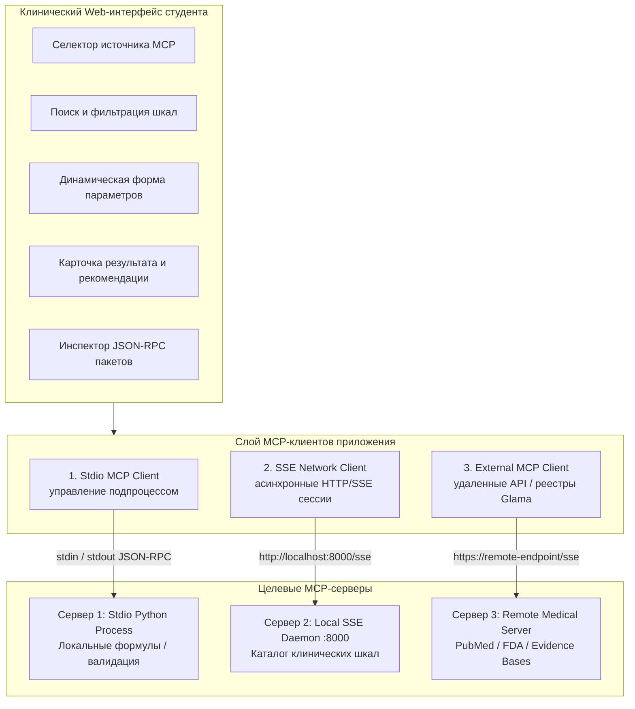

# Практическое задание для студентов

**Курс:** «Программная инженерия мультиагентных систем клинической медицины»  
**Учебное заведение:** Университет Иннополис  
**Семестр:** Осень 2026  
**Тема:** «Архитектура и реализация протокола Model Context Protocol (MCP) в клинических веб-приложениях: три паттерна интеграции инструментов»

---

## 1. Введение и цели работы

### 1.1. Контекст

В мультиагентных системах клинической медицины языковые модели (LLM) выступают в роли координаторов и диагностов-ассистентов, однако они подвержены галлюцинациям и ошибкам в детерминированных математических и фармакологических расчетах. Открытый стандарт **Model Context Protocol (MCP)** решает эту проблему, стандартизируя способ подключения внешних инструментов (tools), баз знаний и калькуляторов к интеллектуальным агентам и интерфейсам.

### 1.2. Цели практической работы

1. Освоить архитектурные принципы протокола MCP (JSON-RPC 2.0, Host, Client, Server, Tools, Transports).
2. Реализовать и интегрировать в собственное веб-приложение **три различных паттерна взаимодействия по протоколу MCP**:
   - **Вариант 1 (Изолированный локальный транспорт):** подключение сервера через стандартные потоки ввода-вывода (**stdio**).
   - **Вариант 2 (Локальный сетевой микросервис):** подключение сервера через локальный сетевой порт по протоколу **SSE (Server-Sent Events)** или **Streamable HTTP**.
   - **Вариант 3 (Внешний распределенный сервис):** интеграция удаленного сервера доказательной медицины из каталогов и экосистемных репозиториев (например, каталог [Glama.ai](https://glama.ai/mcp/servers), реестры MCP).
3. Разработать адаптивный пользовательский веб-интерфейс (Streamlit / FastAPI + React), визуализирующий как работу клинических инструментов, так и сам протокольный обмен JSON-RPC.

---

## 2. Архитектура решения

Студентам необходимо построить систему, поддерживающую маршрутизацию запросов к трем независимым поставщикам MCP-инструментов:

### Сравнительный анализ транспортов протокола MCP

| Параметр | 1. Локальный Stdio | 2. Локальный сетевой (SSE/HTTP) | 3. Внешний сетевой (Remote) |
| :--- | :--- | :--- | :--- |
| **Канал связи** | Анонимные каналы ОС (`stdin` / `stdout`) | TCP-сокет, HTTP/SSE эндпоинт | Глобальная сеть Интернет, TLS/HTTPS |
| **Жизненный цикл** | Запускается как дочерний процесс хоста | Независимый фоновый демон/сервис | Внешний облачный сервис |
| **Изоляция и сбои** | Падение процесса изолировано, не ломает ОС | Отказ сетевого сервиса обрабатывается по кодам HTTP | Требует учета сетевых задержек, таймаутов и ретраев |
| **Масштабируемость** | 1 клиент = 1 процесс на том же узле | Несколько агентов на одной машине | Множество клиентов и мультиагентных систем |
| **Применение** | Быстрые закрытые расчеты, чувствительные данные | Локальные микросервисы клиники, базы калькуляторов | Общедоступные медицинские базы (PubMed, FDA, реестры) |

---

## 3. Детальные требования к заданиям

### Задание 1. Реализация локального сервера по транспорту `stdio`

Студент должен разработать собственный локальный MCP-сервер на Python (с использованием официального `mcp` SDK версии 2.x) и клиентский коннектор к нему.

#### Требования к серверу

1. Запуск через команду: `python -m <имя_модуля>.server`.
2. Сервер обменивается сообщениями по стандарту JSON-RPC 2.0 через `sys.stdin` и `sys.stdout`. Журналирование (логирование) должно направляться **строго в `sys.stderr`**, чтобы не нарушать протокольный поток.
3. Сервер должен реализовывать как минимум **3 клинических инструмента** с обязательной строгой типизацией параметров (Pydantic / type hints):
   - *Примеры:* Расчет ИМТ (BMI), оценка СКФ по креатинину (CKD-EPI или Cockcroft-Gault), оценка кардиологического риска (CHA₂DS₂-VASc или SCORE2), индекс комы Глазго (GCS).
4. Реализовать мета-инструмент `list_calculators`, возвращающий клиническое описание методики, допустимые границы параметров и единицы измерения.

#### Требования к клиенту `stdio`

1. Управление процессом через `subprocess.Popen` или асинхронный контекстный менеджер SDK `stdio_client`.
2. Корректная обработка жизненного цикла: отправка `initialize`, вызов `tools/list`, вызов `tools/call` и корректное закрытие каналов (`shutdown`).
3. Преобразование серверных исключений `ValueError` в структурированные сообщения об ошибках (`ToolError`), понятные пользователю.

---

### Задание 2. Реализация локального сетевого MCP-сервера на порту

Студент должен настроить или разработать сетевой MCP-сервер, слушающий отдельный локальный порт (например, `http://127.0.0.1:8000/sse`), и клиентский модуль интеграции.

#### Требования к серверу

1. Использование сетевого фреймворка (FastMCP, Starlette/Uvicorn, FastAPI).
2. Реализация протокола **Server-Sent Events (SSE)**:
   - Эндпоинт `/sse` для инициализации сессии и подписки на входящие события.
   - Эндпоинт `/messages?session_id=...` для отправки POST-запросов JSON-RPC.
3. Сервер должен содержать расширенный набор инструментов (не менее 5 инструментов) с разбиением по медицинским нозологиям (кардиология, нефрология, реанимация и т.д.).
4. Валидация граничных условий параметров: при выходе показателей за физиологические границы сервер должен возвращать информативное предупреждение, а не аварийно падать.

#### Требования к сетевому клиенту

1. Асинхронное подключение через `httpx_sse` или `mcp.client.sse`.
2. Функция автосанитизации входных данных (Sanitizer): автоматическое приведение типов, подстановка физиологически безопасных значений по умолчанию (Smart Defaults) для предотвращения ошибок валидации.
3. Реализация пула повторных попыток при кратковременной недоступности сетевого порта.

---

### Задание 3. Интеграция внешнего распределенного MCP-сервера

Студент должен подключить в единый интерфейс внешний/публичный MCP-сервер, предоставляющий доступ к внешним доказательным медицинским базам или клиническим сервисам.

#### Источники для выбора сервера

- Каталог серверов **[Glama.ai](https://glama.ai/mcp/servers)** (категории *Healthcare*, *Science*, *Search*).
- Пакет доказательной медицины **`medical-mcp`** (инструменты OpenFDA, PubMed, DailyMed, RxNorm).
- Общедоступные открытые MCP-серверы научных публикаций или биомедицинских справочников.

#### Требования к интеграции

1. Возможность вызова внешнего инструмента из веб-интерфейса (например, поиск аннотации препарата в FDA или поиск статей в PubMed по названию нозологии).
2. Обработка внешних сетевых задержек: отображение индикатора загрузки (spinner), защита от зависания интерфейса (таймаут не более 10–15 секунд).
3. Кэширование результатов внешних запросов для предотвращения исчерпания сетевых лимитов (Rate Limits).

---

### Задание 4. Разработка Web-интерфейса и JSON-RPC инспектора

Создание интерактивного веб-приложения (рекомендуется **Streamlit** или **FastAPI + Vue/React**).

#### Обязательные компоненты интерфейса

1. **Переключатель источника (MCP Source Selector):**
   - Радиокнопка или выпадающий список: `Локальный stdio` / `Локальный сетевой (порт 8000)` / `Внешний сервис доказательной медицины`.
2. **Поиск и фильтрация инструментов:**
   - Поисковая строка с автодополнением по русским и латинским названиям шкал/инструментов.
3. **Генератор клинических форм:**
   - Автоматическое построение полей ввода на основе JSON-схемы выбранного инструмента (числовые поля со слайдерами/шагами, выпадающие списки enum для категориальных параметров, флажки checkbox для факторов риска).
4. **Визуализация результатов:**
   - Главное значение/балл крупным шрифтом.
   - Цветовая индикация риска (зеленый / желтый / красный).
   - Подробная расшифровка компонентов расчета и клинические рекомендации.
   - Ссылка на первоисточник методики (DOI / PubMed).
5. **Инспектор протокола MCP (MCP Packet Inspector):**
   - Раскрывающийся аккордеон в нижней части экрана с отображением:
     - Сырого JSON-RPC запроса (`method`: `tools/call`, `params`: `{...}`).
     - Сырого JSON-RPC ответа сервера (`result`: `{content: [...]}`).

---

## 4. Этапы выполнения и рекомендации по разработке

1. **Шаг 1. Локальное окружение:** Настройте Python 3.11/3.12, создайте виртуальное окружение `.venv`, установите пакет `mcp>=1.3.0`.
2. **Шаг 2. Разработка stdio-сервера:** Проверьте его работоспособность в консоли и подключите к Cursor (`.cursor/mcp.json`) для проверки распознавания инструментов ИИ-агентом.
3. **Шаг 3. Сетевой сервер:** Разверните FastMCP сервер на порту `8000`, протестируйте SSE-подключение через `curl` или HTTP-клиент.
4. **Шаг 4. Внешний сервер:** Подключите внешний сервис доказательной медицины, настройте обработку таймаутов.
5. **Шаг 5. Объединение в GUI:** Реализуйте единый клиентский роутер в Streamlit, связывающий форму с тремя клиентами.

---

## 5. Критерии оценки (100-балльная шкала)

| Критерий | Макс. балл | Описание требований |
| :--- | :---: | :--- |
| **1. Реализация Stdio MCP** | **30** | Корректный обмен по stdin/stdout, не менее 3 калькуляторов, Pydantic-валидация, отсутствие мусора в stdout, изоляция ToolError. |
| **2. Сетевой локальный сервер (порт)** | **30** | Корректный запуск SSE-демона на порту, асинхронный клиент, автосанитизация входных параметров, физиологические границы. |
| **3. Внешний MCP-сервер** | **20** | Подключение инструмента доказательной медицины (PubMed/FDA/Glama), обработка сетевых ошибок и таймаутов. |
| **4. Пользовательский веб-интерфейс** | **15** | Удобный UI, переключатель источников, динамические формы, цветовая стратификация риска, компонентный разбор. |
| **5. Протокольный инспектор JSON-RPC** | **5** | Наглядное отображение сырых JSON-RPC запросов и ответов для демонстрации протокола. |
| **Штрафные баллы** | *-10* | Падение веб-приложения при передаче некорректных данных (отсутствие перехвата исключений). |
| **Штрафные баллы** | *-15* | Использование прямых функций вместо вызова через протокол MCP. |

---

## 6. Требования к оформлению и сдаче

Студент предоставляет:

1. **Репозиторий на GitHub / GitLab:**
   - Исходный код серверов, клиентского слоя и веб-приложения.
   - Чистый файл `.gitignore` (исключающий виртуальные окружения, кэши и временные дампы).
   - Файл `README.md` с инструкцией по развертыванию одной командой.
   - Конфигурационный файл для подключения к IDE (например, `.cursor/mcp.json`).
2. **Демонстрация работы (на защите):**
   - Показ вычисления по одному инструменту из каждого из трех источников.
   - Демонстрация инспектора JSON-RPC пакетов.
   - Ответы на теоретические вопросы по спецификации MCP.

---

## 7. Контрольные вопросы для защиты работы

1. Чем архитектура Model Context Protocol отличается от классических REST API и OpenAPI спецификаций при работе с ИИ-агентами?
2. Почему в транспорте `stdio` категорически запрещено использовать `print()` для логирования внутри сервера? Куда должны направляться логи?
3. Какова структура стандартного JSON-RPC 2.0 сообщения для инициализации сессии (`initialize`) и вызова инструмента (`tools/call`)?
4. Какие преимущества и недостатки у транспорта `SSE` по сравнению со `stdio` при масштабировании на команду врачей?
5. Как защитить медицинский калькулятор от галлюцинаций LLM при автоматической передаче параметров из истории болезни пациента?
